<!-- animated contribution graph: real data, boxes reveal cell by cell
     (regenerated daily by .github/workflows/update-profile-art.yml) -->

<h3><code>mahito@github ~ $ ./contributions.sh</code></h3>

 
 

<!-- ascii portrait (left) + streak/numbers card (right). both svgs are
     840x880 so equal widths give equal heights. -->

<h3><code>mahito@github ~ $ whoami</code></h3>

<table>
<tr>
<td valign="top"></td>
<td valign="top"></td>
</tr>
</table>

 
 

<h3><code>mahito@github ~ $ ./links.sh</code></h3>

<b>Final Year CSE Student · Passionate SQA Engineer · AIUB</b>

  
  
  
  
  

 
 

<h3><code>mahito@github ~ $ cat tech-stack.log</code></h3>

<table align="center">
  <tr>
    <td align="center"><b>Testing & Tools</b></td>
    <td align="center">
      
      
      
      
    </td>
  </tr>
  <tr>
    <td align="center"><b>Languages</b></td>
    <td align="center">
      
      
      
      
      
      
    </td>
  </tr>
  <tr>
    <td align="center"><b>Web & Frameworks</b></td>
    <td align="center">
      
      
      
    </td>
  </tr>
  <tr>
    <td align="center"><b>Databases & Server</b></td>
    <td align="center">
      
      
      
    </td>
  </tr>
</table>

 

